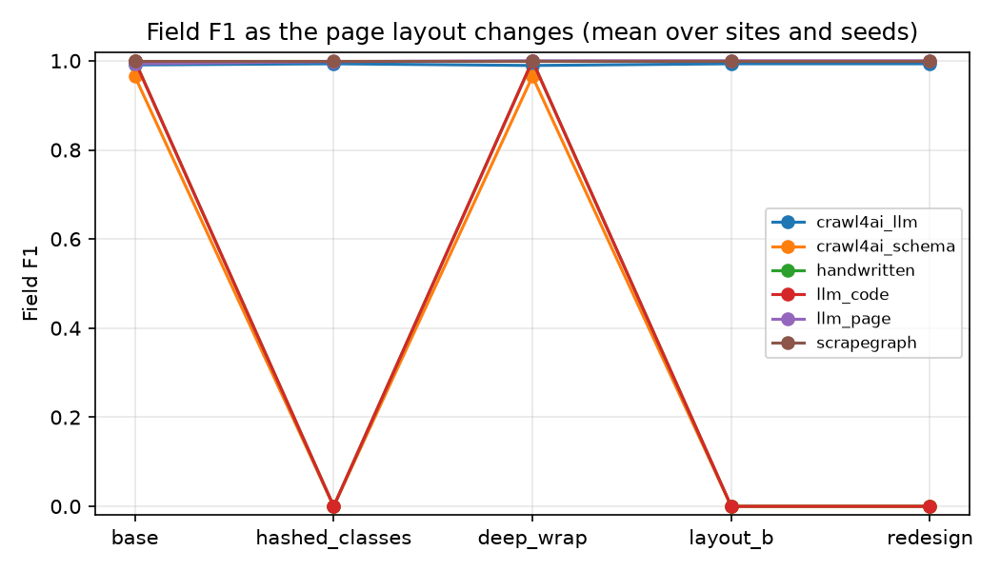

# web-extraction-eval

[](https://github.com/rabiayrk/web-extraction-eval/actions/workflows/ci.yml)
[](LICENSE)

Benchmarks such as WebArena and Mind2Web ask whether a web agent finished a task. This
repository asks a different question: how well does a system collect structured data from
a website? It generates small synthetic sites on your machine, so the true records are
known and no real site is loaded. Then it changes those sites in controlled ways (paging,
content loaded by JavaScript, new layout, renamed CSS classes, missing fields, changed
data) and measures field accuracy, coverage, duplicates, wrong merges, freshness and cost
for each system.

## What is measured

| Metric | Definition |
|---|---|
| Field precision, recall, F1 | Micro averaged over all fields of all records. A field counts as correct when the normalized predicted value equals the true value. A wrong value counts as one false positive and one false negative. Correct nulls are not counted. |
| Coverage | Share of true records that were matched to a predicted record. |
| Duplicate rate | Extra predicted records for a true record that is already matched, divided by all predicted records. |
| Wrong merge rate | Some records are near copies by design (the same product in two colors, the same job in two cities). A copy counts as lost to a merge when it is missing while its sibling was found on a page the system read. Divided by copies on read pages. |
| Change F1 | The system runs on version 1 and version 2 of the same site. True changes are edited fields, added records and removed records. Change F1 compares the changes the system's two outputs imply with the true changes. |
| Cost | Requests, LLM input and output tokens, US dollars and seconds, per matched record. One time setup cost is reported on its own. |

Records are matched one to one. A predicted record with a known key (`sku` or `ref`) is
matched to that record. The rest are matched with the Hungarian algorithm on the share of
agreeing fields, with a threshold of 0.5. Values are normalized before comparison: text is
lower cased with spaces collapsed, numbers are read from strings like `$1,234.50` or
`80k`, booleans from words like `In stock` or `Remote`, dates from common formats. A strict
variant that only accepts values already in the right type is reported too.

## Sites and variants

Two site types, each built from seeded random records made from small word lists:

* **shop**: 60 products on 5 pages, with a "Featured" box that repeats two products on
  every page.
* **jobs**: 12 companies with 2 to 5 openings each, plus near copies, 3 companies per
  page. Each job sits inside its company block, so the company name has to be carried
  down to the job.

| Variant | Change from base |
|---|---|
| base | numbered pages, server side HTML, layout A, readable class names |
| next_only | only a "Next page" link, no page numbers and no `rel=next` |
| load_more | first page plus a "Load more" button that fetches more items |
| infinite | more items load when you scroll |
| csr | items are inserted by JavaScript from a JSON file |
| layout_b | the same data as a table with other labels and formats |
| hashed_classes | class names replaced by random strings |
| deep_wrap | every field wrapped in three extra `div` elements |
| redesign | layout_b, hashed_classes and deep_wrap together |
| sparse | 45% of optional fields missing instead of 15 to 20% |
| fresh_v2 | about 20% of records edited, 10% removed, 10% added |

Seed 0 of the base variant is the development site. Systems that need setup (writing
code or selectors) only see this site. Results use seeds 1 to 5.

## Systems

| Name | How it works |
|---|---|
| handwritten | parsel selectors written by hand for the development site |
| llm_page | Claude reads every page (simplified HTML) and returns records and the next link as JSON with a fixed schema |
| llm_code | Claude writes a Python scraper once from the development page, with up to two fix rounds if it crashes or returns nothing. The code then runs on every page with no LLM calls. |
| crawl4ai_llm | crawl4ai 0.9.5 `LLMExtractionStrategy`, one call per page on crawl4ai's markdown |
| crawl4ai_schema | crawl4ai 0.9.5 `generate_schema` writes CSS selectors once on the development page, then `JsonCssExtractionStrategy` runs with no LLM calls |
| scrapegraph | ScrapeGraphAI 2.3.1 `SmartScraperGraph`, one call per page, with a Pydantic schema |

All LLM systems use `claude-haiku-5-5` with the model's default effort. Every system gets
the same pages from a shared fetcher: Chromium through Playwright, which also scrolls and
clicks "Load more" until the page stops growing. So the loading variants test whether a
system can read the final page, not whether it can drive a browser. When a system returns
no next page link, the same generic rule (a link with `rel=next` or text starting with
"next") is tried for every system.

## Results

All numbers below come from `scripts/report.py` and are also in
[`results/tables.md`](results/tables.md), with tables per site, per variant and per field.
Results use the browser fetcher, 2 site types, 11 variants and 5 seeds: 110 site instances
per system. Brackets are 95% bootstrap intervals over the 10 (site, seed) clusters.

| System | Field F1, base | Coverage, loading variants | Field F1, layout variants | Field F1, redesign | USD per 1k records |
|---|---|---|---|---|---|
| crawl4ai_llm | 0.99 [0.98, 1.00] | 1.00 [1.00, 1.00] | 0.99 [0.99, 1.00] | 0.99 [0.99, 1.00] | 0.111 |
| crawl4ai_schema | 0.96 [0.94, 0.99] | 1.00 [1.00, 1.00] | 0.24 [0.24, 0.25] | 0.00 [0.00, 0.00] | 0.000 |
| handwritten | 1.00 [1.00, 1.00] | 1.00 [1.00, 1.00] | 0.25 [0.25, 0.25] | 0.00 [0.00, 0.00] | 0.000 |
| llm_code | 1.00 [1.00, 1.00] | 1.00 [1.00, 1.00] | 0.25 [0.25, 0.25] | 0.00 [0.00, 0.00] | 0.000 |
| llm_page | 0.99 [0.99, 1.00] | 1.00 [1.00, 1.00] | 1.00 [1.00, 1.00] | 1.00 [1.00, 1.00] | 0.081 |
| scrapegraph | 1.00 [1.00, 1.00] | 1.00 [1.00, 1.00] | 1.00 [1.00, 1.00] | 1.00 [1.00, 1.00] | 0.096 |

Coverage is the share of true records found. "Layout variants" is the mean of layout_b,
hashed_classes, deep_wrap and redesign.



| System | Field F1, base, strict types | Duplicate rate | Wrong merge rate | Change F1 (freshness) | Setup USD | Requests per record | Seconds per record |
|---|---|---|---|---|---|---|---|
| crawl4ai_llm | 0.99 [0.98, 1.00] | 0.013 [0.005, 0.022] | 0.000 [0.000, 0.000] | 1.00 [1.00, 1.00] | 0.0000 | 0.09 | 0.669 |
| crawl4ai_schema | 0.65 [0.51, 0.79] | 0.000 [0.000, 0.000] | 0.000 [0.000, 0.000] | 1.00 [1.00, 1.00] | 0.0098 | 0.12 | 0.091 |
| handwritten | 1.00 [1.00, 1.00] | 0.000 [0.000, 0.000] | 0.000 [0.000, 0.000] | 1.00 [1.00, 1.00] | 0.0000 | 0.12 | 0.136 |
| llm_code | 1.00 [1.00, 1.00] | 0.000 [0.000, 0.000] | 0.000 [0.000, 0.000] | 1.00 [1.00, 1.00] | 0.0024 | 0.12 | 0.090 |
| llm_page | 0.99 [0.99, 1.00] | 0.005 [0.001, 0.008] | 0.000 [0.000, 0.000] | 1.00 [1.00, 1.00] | 0.0000 | 0.09 | 0.490 |
| scrapegraph | 1.00 [1.00, 1.00] | 0.000 [0.000, 0.001] | 0.000 [0.000, 0.000] | 1.00 [1.00, 1.00] | 0.0000 | 0.09 | 0.554 |

Duplicate and wrong merge rates use only runs that found at least one record.

Main findings:

* **Selectors break, page readers do not.** The three systems that write selectors or code
  once (handwritten, llm_code, crawl4ai_schema) score 0.96 to 1.00 on the base site and
  0.00 on layout_b, hashed_classes and redesign. Extra wrapper elements (deep_wrap) do not
  hurt them, because their selectors do not depend on exact nesting. The three systems
  that call the model on every page score 0.99 or 1.00 on every variant (rounded). In the
  plot, handwritten is hidden under llm_code.
* **The gap is large and clear; the gaps between page readers are not.** On the four
  layout variants, llm_page is 0.750 above llm_code and handwritten, and crawl4ai_llm is
  0.751 above crawl4ai_schema (Holm adjusted p = 0.010 for each, 10 clusters; with 10
  clusters the smallest possible exact p value is 0.002). llm_page and scrapegraph do not
  differ. llm_page minus crawl4ai_llm is +0.007, which is not significant after
  correction (p = 0.125).
* **Every system read every loading variant.** Coverage is 1.00 for all systems on
  next_only, load_more, infinite and csr. This is mostly the shared browser fetcher and the
  shared next link rule, not the tools themselves (see Limitations).
* **Per page reading costs about 8 to 11 US cents per 1,000 records** with
  `claude-haiku-5-5`. The two systems that use the model only once for setup paid about
  one cent or less each, and nothing per page.
* **crawl4ai_schema has two problems the main F1 hides.** It cannot carry the company name
  from the company block down to each job (company F1 0.00 on jobs), and with strict types
  its base F1 falls from 0.96 to 0.65 because it returns numbers and booleans as raw
  text such as `"170,000"` and `"In stock"`.
* **Duplicates are rare.** crawl4ai_llm has the highest rate (1.3%), llm_page 0.5%. Wrong
  merges did not happen in any run.

Paired comparisons on the four layout variants (exact sign flip test, Holm adjusted):

| Comparison | Mean F1 difference | 95% CI | p (sign flip) | p (Holm) | Clusters |
|---|---|---|---|---|---|
| llm_page minus llm_code | +0.750 | [+0.749, +0.750] | 0.002 | 0.010 | 10 |
| llm_page minus handwritten | +0.750 | [+0.749, +0.750] | 0.002 | 0.010 | 10 |
| crawl4ai_llm minus crawl4ai_schema | +0.751 | [+0.741, +0.761] | 0.002 | 0.010 | 10 |
| llm_page minus crawl4ai_llm | +0.007 | [+0.002, +0.013] | 0.062 | 0.125 | 10 |
| llm_page minus scrapegraph | -0.000 | [-0.001, +0.000] | 1.000 | 1.000 | 10 |

### Live check on quotes.toscrape.com

`scripts/live_quotes.py` runs the LLM systems on two versions of a public practice site
(the `js` page builds quotes with JavaScript, the `scroll` page loads them on scroll) and
compares them with the 100 quotes on its plain HTML pages.

| System | Version | Field F1 | Coverage | Duplicate rate | Records | Cost USD |
|---|---|---|---|---|---|---|
| llm_page | js | 1.00 | 1.00 | 0.000 | 100 | 0.0054 |
| llm_page | scroll | 1.00 | 1.00 | 0.000 | 100 | 0.0046 |
| llm_code | js | 1.00 | 1.00 | 0.000 | 100 | 0.0007 |
| llm_code | scroll | 1.00 | 1.00 | 0.000 | 100 | 0.0000 |
| crawl4ai_llm | js | 0.99 | 1.00 | 0.000 | 100 | 0.0109 |
| crawl4ai_llm | scroll | 0.99 | 1.00 | 0.000 | 100 | 0.0064 |
| crawl4ai_schema | js | 0.00 | 0.00 | 0.000 | 100 | 0.0014 |
| crawl4ai_schema | scroll | 0.00 | 0.00 | 0.000 | 100 | 0.0000 |
| scrapegraph | js | 0.97 | 1.00 | 0.000 | 100 | 0.0082 |
| scrapegraph | scroll | 0.99 | 1.00 | 0.000 | 100 | 0.0064 |

crawl4ai_schema scores 0.00 because the selectors it generated use "transform" steps that
crawl4ai 0.9.5 skips without a warning, so quotes keep their quote marks and tags keep a
"Tags:" prefix.

### Two tool findings

* crawl4ai 0.9.5 sends `temperature=0.01` by default. `claude-haiku-5-5` rejects this with
  HTTP 400 (`temperature` is deprecated for this model), so every call fails. The adapter
  passes `temperature=None`.
* crawl4ai puts the page URL into the prompt, and the model then answers with an absolute
  next link. A cache keyed only by page content shares one answer between two pages with
  the same content and different URLs, and the crawl follows the wrong next link. The
  adapter keys the cache by URL too.

## Install and run

You need Python 3.12 and [uv](https://docs.astral.sh/uv/).

```bash
git clone https://github.com/rabiayrk/web-extraction-eval
cd web-extraction-eval
uv sync --all-extras
uv run playwright install chromium
```

Rebuild every table from the stored raw outputs (no API key, no browser):

```bash
scripts/rescore.sh
```

Run everything again, including the LLM calls:

```bash
cp .env.example .env   # then add ANTHROPIC_API_KEY
scripts/reproduce.sh
```

A full run makes 1,279 Claude calls. With `claude-haiku-5-5` at $0.10 per million
input tokens and $0.50 per million output tokens (prices on 2026-11-16), it cost
$1.78 (nominal cost of all calls in the stored results). Development runs and one
rerun brought the money actually spent to about $2.30. Every call is cached in `.cache/`,
so a second run on the same machine is free. `WXEVAL_BUDGET_USD` sets a hard stop
(default 20), and every paid call is logged to `results/spend.jsonl`.

Useful options:

```bash
# one system, a few variants, no LLM, no browser
uv run python scripts/run_experiments.py --systems handwritten --fetch http --smoke
# only some variants and seeds
uv run python scripts/run_experiments.py --systems llm_page --variants base,redesign --seeds 1
```

## Add a system

A system is one class in one file under `wxeval/systems/`. Register it in
`wxeval/systems/registry.py` and pass its name to `--systems`.

```python
from parsel import Selector

from wxeval.systems.base import Context, System, Task, crawl


class FirstLinkTexts(System):
    name = "first_link_texts"

    def prepare(self, dev: Task, ctx: Context) -> None:
        pass  # optional one time setup on the development site

    def extract(self, task: Task, ctx: Context) -> list[dict]:
        def page(html: str, url: str):
            sel = Selector(html)
            records = [{"name": t} for t in sel.css("h2::text").getall()]
            return records, None  # records on this page, next page link or None

        return crawl(task.start_url, ctx, page)
```

`task.schema` lists the fields and their types. `ctx.claude` is the cached Claude client
with the budget check, for systems that set `uses_llm = True`.

## Repository layout

```
wxeval/sites/     site generator, variants, static server
wxeval/systems/   systems under test and the shared crawl loop
wxeval/eval/      normalization, matching, metrics, statistics
wxeval/report.py  scoring of raw outputs
scripts/          run, report, live check, reproduction
results/          raw outputs, tables, plot, spend log
tests/            metric and generator tests
```

## Limitations

* **One template family per site type.** Every shop and every jobs site comes from the
  same generator, so five seeds are five data sets, not five site designs. The intervals
  describe variation over data, not over site designs.
* **One LLM sample per instance.** Each prompt is answered once and cached. Run to run
  variation of the model is not measured.
* **Lenient normalization.** Values like `$1,234.50` and `1234.5` count as equal. The
  strict column in the second table shows how much this matters.
* **Correct nulls are not counted.** A system that leaves a missing field empty gets no
  credit for it, and one that invents a value gets a false positive.
* **Change F1 mostly follows coverage and field accuracy.** A system that reads both
  versions well also finds the changes. It is reported because it fails differently when a
  system drops pages on one version only.
* **Generated code runs without a sandbox.** `llm_code` runs the model's code in a
  separate Python process with `-I`, but with normal file and network access. The code is
  saved in `build/work/llm_code/`. Read it before you run it on your machine.
* **Different inputs.** crawl4ai_llm reads markdown, scrapegraph reads HTML through its
  own parser, llm_page reads simplified HTML. Markdown has no class names and no wrapper
  elements, so for crawl4ai_llm the hashed_classes and deep_wrap pages are the same input
  as base.
* **Shared help.** Every system gets the same browser, scrolling, "Load more" clicks and
  the same generic next link rule. The loading results therefore say little about a
  tool's own crawler.
* **No wrong merges were seen.** The near copies were never merged by any system (0 of
  9,108 cases), so this run cannot rank systems on that metric.
* **One model.** All LLM systems use `claude-haiku-5-5`. Other models can change the
  ranking.

## Related work

To our knowledge, no public benchmark combines self hosted sites with exact ground truth,
controlled layout changes, coverage by loading mechanism, duplicate and merge rates as
extraction metrics, and freshness. Closest work:

* LiveWeb-IE (Yang et al., ICLR 2026, [arXiv:2603.13773](https://arxiv.org/abs/2603.13773)): field P/R/F1 on live sites; an appendix measures the F1 drop between old and new versions of real pages.
* NEXT-EVAL ([arXiv:2505.17125](https://arxiv.org/abs/2505.17125)): record level P/R/F1 with Hungarian matching on page snapshots.
* WebLists ([arXiv:2504.12682](https://arxiv.org/abs/2504.12682)): list extraction by agents on live sites, with cost per correct row.
* WebMall ([arXiv:2508.13024](https://arxiv.org/abs/2508.13024)): self hosted shops for shopping agents, with token and cost metrics.
* AutoScraper ([arXiv:2404.12753](https://arxiv.org/abs/2404.12753)): LLM generated scrapers evaluated on SWDE.
* Beyond BeautifulSoup ([arXiv:2601.06301](https://arxiv.org/abs/2601.06301)): success rate of LLM scraping tools across access difficulty levels.
* Vendor benchmarks: Zyte's scraping code benchmark (blog, July 2026) and Firecrawl's scrape quality benchmark.
* Task benchmarks: WebArena ([arXiv:2307.13854](https://arxiv.org/abs/2307.13854)), Mind2Web ([arXiv:2306.06070](https://arxiv.org/abs/2306.06070)), BrowserGym ([arXiv:2412.05467](https://arxiv.org/abs/2412.05467)).

## Data and licenses

* All site records are synthetic, built from word lists in `wxeval/sites/data.py`. They
  describe no real product, company or person.
* The live check reads [quotes.toscrape.com](https://quotes.toscrape.com), a practice site
  run by Zyte for scraping exercises. It has no robots.txt. The script checks robots.txt
  anyway, waits at least two seconds between requests, and fetches each page once. Quote
  texts are not stored in this repository; only scores are.
* crawl4ai is Apache-2.0, ScrapeGraphAI is MIT, parsel is BSD-3-Clause, Playwright is
  Apache-2.0.

## License

MIT. See [LICENSE](LICENSE).
